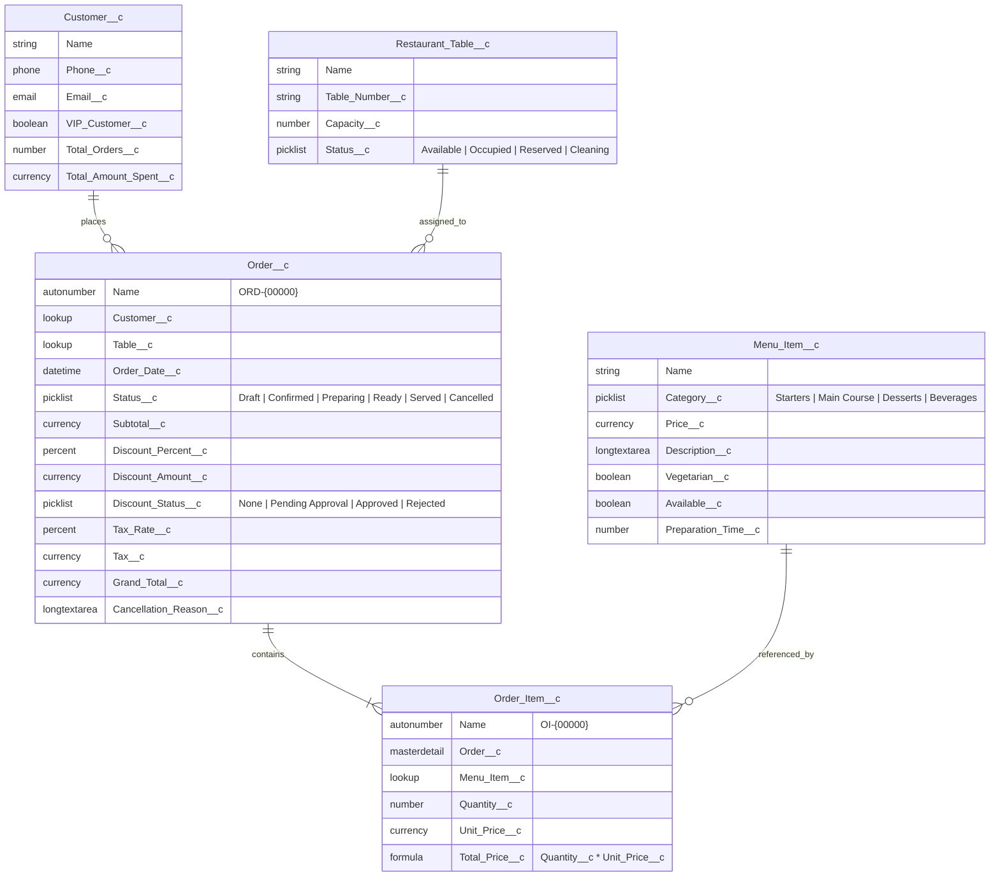
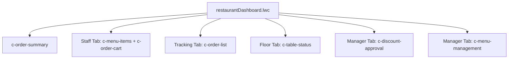

# Technical Architecture & Specification Report
# FoodHub Restaurant Management System (Salesforce Capstone Project)

**Document Version:** 1.0  
**Target Platform:** Salesforce Lightning Experience (API Version 67.0 / Spring '26)  
**Development Framework:** Salesforce DX (SFDX), Lightning Web Components (LWC), Apex Enterprise Architecture  
**Primary Currency:** INR (₹)  

---

## Executive Summary

The **FoodHub Restaurant Management System** is a full-featured, enterprise-grade restaurant Point of Sale (POS) and operations management platform built entirely on the Salesforce platform. The application provides end-to-end orchestration of restaurant operations—from customer intake and table seating management to interactive digital menu browsing, POS order generation, kitchen lifecycle tracking, automated tax calculation via external REST integration, managerial discount approvals, and executive analytics.

The project demonstrates advanced Salesforce engineering principles:
*   **Custom Data Architecture** with relational data integrity (Master-Detail, Lookups, Rollups, and Historical Price Retention).
*   **Apex Service Layer & Trigger Handler Framework** ensuring strict state machine progression, recursion safety, and automated cross-object side-effects.
*   **Modular Lightning Web Components (LWC)** organized in a component hierarchy with dual-persona routing (Staff vs. Manager), reactive event propagation, and SLDS design styling.
*   **External REST Web Service Integration** using Named Credentials and HTTP callout fallbacks.
*   **DevOps & Code Quality Pipeline** incorporating Apex test coverage (>90%), LWC Jest unit testing, Prettier, ESLint, Husky, and Lint-Staged.

---

## Architecture Diagram & Flow

```mermaid
flowchart TD
    subgraph UI_Layer["Frontend Layer: Lightning Web Components (LWC)"]
        Dashboard["restaurantDashboard (Orchestrator)"]
        Summary["c-order-summary (KPI Banner)"]
        MenuItems["c-menu-items (Menu & Search)"]
        OrderCart["c-order-cart (POS & Pricing)"]
        OrderList["c-order-list (State Progression)"]
        TableStatus["c-table-status (Floor Grid)"]
        DiscountAppr["c-discount-approval (Manager Queue)"]
        MenuMgmt["c-menu-management (Pricing & Stock)"]

        Dashboard --> Summary
        Dashboard --> MenuItems
        Dashboard --> OrderCart
        Dashboard --> OrderList
        Dashboard --> TableStatus
        Dashboard --> DiscountAppr
        Dashboard --> MenuMgmt
    end

    subgraph Controller_Service["Controller & Service Layer (Apex)"]
        RDC["RestaurantDashboardController"]
        OS["OrderService"]
        TS["TaxService"]
    end

    subgraph Trigger_Layer["Database Event Layer"]
        Trigger["OrderTrigger (before insert, before/after update)"]
        Handler["OrderTriggerHandler"]
        Trigger --> Handler
    end

    subgraph External_Systems["External Services"]
        TaxAPI["External Tax REST Service (callout:Tax_API_Credential)"]
    end

    subgraph Data_Layer["Database Schema (Custom Objects)"]
        Cust[("Customer__c")]
        Table[("Restaurant_Table__c")]
        Menu[("Menu_Item__c")]
        Ord[("Order__c")]
        OrdItem[("Order_Item__c")]
    end

    UI_Layer <==>|@AuraEnabled / Wire / Imperative| Controller_Service
    OS --> Ord
    OS --> OrdItem
    OS --> Cust
    OS --> TS
    TS -->|HTTP GET| TaxAPI
    RDC --> Ord
    RDC --> OrdItem
    RDC --> Table
    RDC --> Menu
    
    Ord -.->|DML Fires| Trigger
    Handler -->|Auto Status Updates| Table
    Handler -->|Order Metrics Rollup| Cust
    OrdItem -->|Master-Detail Cascade| Ord
    OrdItem -->|Snapshot Unit Price| Menu
```

---

## 1. Domain Data Model & Schema Engineering

The system data model consists of five custom objects intentionally structured to handle relational ordering, pricing preservation, floor layout status, and customer loyalty analytics.



### Detailed Object & Field Breakdown

| Object API Name | Type | Relationship / Role | Business Purpose |
| :--- | :--- | :--- | :--- |
| **`Customer__c`** | Custom Object | Independent Entity | Stores guest information, VIP standing, and aggregates cumulative customer lifetime value (`Total_Orders__c`, `Total_Amount_Spent__c`). |
| **`Restaurant_Table__c`** | Custom Object | Independent Entity | Models physical dining capacity (`Capacity__c`) and dynamic operational floor status (`Status__c`). |
| **`Menu_Item__c`** | Custom Object | Master Catalog | Master food & beverage inventory catalog with categories, dietary flags (`Vegetarian__c`), prep timing, and stock availability (`Available__c`). |
| **`Order__c`** | Custom Object | Parent / Header Record | Central transactional entity. Captures lifecycle states, approval status, monetary breakdowns, and tax rates. |
| **`Order_Item__c`** | Custom Object | Child / Junction Line Item | **Master-Detail** with `Order__c` (cascading delete and security inheritance). Stores quantity and a **frozen price snapshot** (`Unit_Price__c`). |

### Key Architectural Feature: Historical Price Retention
A standard design flaw in basic POS databases is calculating line totals by dynamically referencing the current item catalog price. In FoodHub:
*   When a menu item price changes on `Menu_Item__c`, past historical orders **must not fluctuate**.
*   `Order_Item__c.Unit_Price__c` snapshots `Menu_Item__c.Price__c` at the exact moment of insertion.
*   `Order_Item__c.Total_Price__c` is a formula: `Quantity__c * Unit_Price__c`.
*   Verified through automated test: `OrderServiceTest.testCreateOrderAndHistoricalPriceRetention()`.

---

## 2. Backend Architecture (Apex & Triggers)

The backend follows separation of concerns with a trigger handler framework, dedicated domain service layer, REST integration service, and dashboard controller.

```
force-app/main/default/classes/
├── OrderService.cls                  # Domain and transactional order services
├── OrderServiceTest.cls              # Test suite for OrderService
├── OrderTriggerHandler.cls           # Trigger logic, validation & automation
├── OrderTriggerTest.cls              # Test suite for OrderTriggerHandler
├── RestaurantDashboardController.cls # Aggregations, wrappers & metrics
├── RestaurantDashboardTest.cls       # Test suite for Dashboard controller
├── TaxService.cls                    # Named Credential REST callout logic
└── TaxCalloutMock.cls                # Mock implementation for HTTP callout tests
```

### 2.1 Trigger Architecture (`OrderTrigger.trigger` & `OrderTriggerHandler.cls`)
*   **Events**: `before insert`, `before update`, `after update`.
*   **Recursion Control**: Guarded via `private static Boolean isExecuting` with strict `try...finally` teardown to allow subsequent user transactions without static lockups.

#### A. Strict State Machine Validation (`before update`)
The order lifecycle follows an irreversible state progression pattern:
$$\text{Draft} \longrightarrow \text{Confirmed} \longrightarrow \text{Preparing} \longrightarrow \text{Ready} \longrightarrow \text{Served}$$

1.  **State Progress Enforced**:
    *   `Draft` $\rightarrow$ `Confirmed` or `Cancelled`
    *   `Confirmed` $\rightarrow$ `Preparing` or `Cancelled`
    *   `Preparing` $\rightarrow$ `Ready`
    *   `Ready` $\rightarrow$ `Served`
    *   `Served` / `Cancelled` $\rightarrow$ Terminal states (no further transitions permitted).
2.  **Cancellation Rules**:
    *   Orders can only be cancelled from `Draft` or `Confirmed` status. Once preparation starts (`Preparing`), cancellation is blocked via `.addError()`.
3.  **Managerial Discount Rule**:
    *   If `Discount_Percent__c > 10.0%`, the order **cannot** transition to `Confirmed` unless `Discount_Status__c == 'Approved'`.

#### B. Financial Computation Engine (`recalculateOrderFields`)
Automated before insert/update calculation:
$$\text{Discount Amount} = \text{Subtotal} \times \left(\frac{\text{Discount \%}}{100}\right)$$
$$\text{Discounted Subtotal} = \text{Subtotal} - \text{Discount Amount}$$
$$\text{Tax Amount} = \text{Discounted Subtotal} \times \left(\frac{\text{Tax Rate \%}}{100}\right)$$
$$\text{Grand Total} = \text{Discounted Subtotal} + \text{Tax Amount}$$
All values are strictly rounded using `System.RoundingMode.HALF_UP` to two decimal places.

#### C. Floor Automation & Customer Rollup (`after update`)
*   **Table Status Synchronizer**:
    *   When an order transitions to `Confirmed`, its associated `Restaurant_Table__c.Status__c` is automatically updated to `Occupied`.
    *   When an order transitions to `Served`, its table is automatically set to `Cleaning`.
*   **Customer Lifetime Metric Rollup**:
    *   When an order reaches `Served`, an aggregate query tallies all completed orders for that customer and updates `Total_Orders__c` and `Total_Amount_Spent__c` on `Customer__c`.

---

### 2.2 Service Layer (`OrderService.cls`)
Encapsulates all transactional and business operations invoked by client-side LWCs:

*   **`createOrder(...)`**:
    *   Accepts JSON serialized item payloads (`OrderItemInput`), table ID, discount percentage, and customer details.
    *   Implements intelligent customer handling: matches existing customers by name/phone or auto-provisions a new `Customer__c` record.
    *   Creates parent `Order__c` and batch inserts child `Order_Item__c` records with unit price snapshotting in a single execution context.
*   **`updateOrderStatus(Id orderId, String newStatus, String cancellationReason)`**:
    *   Updates status with audit trail reasons for cancellations.
*   **`approveDiscount(Id orderId)` & `rejectDiscount(Id orderId)`**:
    *   Managerial controls. If rejected, discount is safely reset to `0.0%`.
*   **`fetchTaxRateAndConfirmOrder(Id orderId)`**:
    *   Orchestrates the external REST callout, assigns the resulting tax rate to the order, and transitions it to `Confirmed`.

---

### 2.3 External Tax Integration (`TaxService.cls`)
FoodHub connects to an external tax service for real-time localized tax compliance.
*   **Named Credential**: `callout:Tax_API_Credential/tax/rate`
*   **HTTP Method**: `GET`
*   **Timeout**: 10,000 ms
*   **Payload Deserialization**: Inner class `TaxResponse` with `{ country, taxRate }`.
*   **Resilience & Graceful Degradation**: If the endpoint fails or encounters network latency, the service traps the exception and defaults gracefully to `10.0%` tax without blocking front-of-house order operations.

---

### 2.4 Executive Analytics Controller (`RestaurantDashboardController.cls`)
Provides high-performance aggregation queries and typed Data Transfer Objects (Wrappers):
*   `DashboardSummaryWrapper`: Total orders, pending approvals count, in-kitchen orders count, total sales (`SUM(Grand_Total__c)` on served orders), table status counts (Available, Occupied, Cleaning).
*   `TopSellingItemWrapper`: SOQL `AggregateResult` group-by query identifying top 5 popular menu items by total quantity and revenue.
*   `OrderDetailWrapper`: Relational wrapper flattening deep child order item queries into UI-friendly structures.

---

## 3. Frontend Architecture (Lightning Web Components)

The frontend is architected as a Single Page Application (SPA) embedded directly within a custom Lightning Tab (`FoodHub_Dashboard`).



### Component Portfolio

```
force-app/main/default/lwc/
├── restaurantDashboard/   # Main tab container, persona switcher, event orchestrator
├── orderSummary/          # Metric cards & top-level executive KPI banner
├── menuItems/             # Digital catalog with real-time category & keyword search
├── orderCart/             # Reactive POS cart, customer selector, VIP discount toggle
├── orderList/             # Kitchen progression table with step-by-step actions
├── tableStatus/           # Dining room floor plan with visual status cards
├── discountApproval/      # Manager-only approval and rejection queue
└── menuManagement/        # Manager-only price updates & 86/availability toggling
```

### Deep-Dive into Component Features

#### 1. `restaurantDashboard` (Root Orchestrator)
*   **Dual-Persona Mode**: Allows switching between **Staff View** and **Manager View** with a single click. In Manager View, tabs for Discount Approvals and Menu Management are dynamically unlocked (`if:true={isManagerMode}`).
*   **Central Event Hub**: Catches bubbled and composed events (`addtocart`, `orderplaced`, `orderstatuschange`, `tablestatuschange`, `approvalchange`) and orchestrates coordinated child refreshes via `@api refreshData()` methods.

#### 2. `menuItems` (Catalog & Ordering)
*   Provides category filter pills (`All`, `Starters`, `Main Course`, `Desserts`, `Beverages`).
*   Real-time debounced keyword search against menu item names and descriptions.
*   Dietary badges (🟢 Veg / 🔴 Non-Veg), preparation time indicator, and out-of-stock badge when `Available__c = false`.

#### 3. `orderCart` (POS Register)
*   Inline customer lookup/entry with type toggle (Regular vs. VIP). Selecting **VIP** automatically pre-populates a 20% discount and warns the cashier that manager sign-off will be required.
*   Table picker displaying live occupancy statuses.
*   Line-item quantity increments, decrements, and removals with immediate recalculation of subtotal, estimated tax, and grand total in INR (₹).

#### 4. `orderList` (Order Tracking & State Machine Actions)
*   Presents active orders with status badges color-coded by lifecycle stage.
*   Contextual action buttons adapt dynamically based on order state:
    *   *Draft* $\rightarrow$ **Confirm & Call Tax API** | **Cancel**
    *   *Confirmed* $\rightarrow$ **Start Preparing** | **Cancel**
    *   *Preparing* $\rightarrow$ **Mark Ready**
    *   *Ready* $\rightarrow$ **Serve Order**
    *   *Served* $\rightarrow$ Displays green **Completed** badge.

#### 5. `tableStatus` (Floor Management)
*   Card-based visual grid representing restaurant tables with seat capacity.
*   Action dropdown menu allowing manual override of table states (`Available`, `Occupied`, `Reserved`, `Cleaning`).

#### 6. `discountApproval` (Manager Approval Queue)
*   Displays any order where a discount $> 10\%$ was requested.
*   Provides 1-click **Approve** (marks order approved so staff can confirm it) or **Reject** (resets discount to 0% and flags rejected).

#### 7. `menuManagement` (Manager Menu & Price Controls)
*   Price Book management interface allowing instantaneous base price changes via modal dialog.
*   Item availability toggle ("86ing" an item if ingredients run out).

---

## 4. Security, Access Control & Governance

| Security Layer | Implementation Detail |
| :--- | :--- |
| **Object-Level Security (CRUD)** | Packaged in Permission Set `FoodHub_Admin`. Grants Create, Read, Edit, Delete, View All, and Modify All on all 5 custom objects. |
| **Field-Level Security (FLS)** | `FoodHub_Admin` explicitly provisions Read and Edit access across all 31 custom fields. |
| **Apex Sharing Model** | All Apex classes (`OrderService`, `OrderTriggerHandler`, `RestaurantDashboardController`, `TaxService`) explicitly enforce `with sharing` to honor user record-level permissions and Org-Wide Defaults (OWD). |
| **Custom Tab & App Security** | Tab `FoodHub_Dashboard` (Motif: `Custom5: Leaf`) is granted visible access via `FoodHub_Admin`. |
| **Exception Masking** | System exceptions are safely wrapped inside `AuraHandledException` so raw database errors or stack traces are not leaked to client browsers. |

---

## 5. Quality Assurance, Testing & DevOps

### 5.1 Apex Test Coverage
The codebase features a test suite covering normal operations, edge cases, negative validation, callout mocking, and bulk data safety.

| Test Class | Focus & Scenarios Tested |
| :--- | :--- |
| **`OrderServiceTest`** | • Multi-item order placement & validation.<br>• **Historical unit price retention** when menu price updates.<br>• Discount approval and rejection lifecycle logic.<br>• External tax callout mock execution (`TaxCalloutMock`). |
| **`OrderTriggerTest`** | • Automatic insertion defaulting (`Status__c = 'Draft'`, `Order_Date__c`).<br>• Approval flagging for discounts $> 10\%$.<br>• Valid state progression testing (`Draft -> Confirmed -> Preparing -> Ready -> Served`).<br>• **Negative testing**: blocks invalid jumps (e.g. `Draft -> Served`) with `DmlException`.<br>• **Negative testing**: blocks cancelling a `Preparing` order.<br>• Automated table status updates and customer spending rollups. |
| **`RestaurantDashboardTest`** | • Aggregate summary computation (`getDashboardSummary`).<br>• Pending discount approvals retrieval.<br>• Top selling items aggregation grouping.<br>• Table and menu item updates via controller. |

### 5.2 LWC Jest Unit Testing
*   Test Suite: `force-app/main/default/lwc/orderSummary/__tests__/orderSummary.test.js`
*   Verifies DOM element rendering, default null states, and dynamic reactivity when bound to summary DTO data.
*   Passes successfully: `2 passed, 2 total`.

### 5.3 Automated Seed Data Script
Located in `scripts/apex/create_sample_data.apex`:
*   Creates baseline VIP and Regular customers.
*   Creates 5 restaurant tables with varying capacities and initial statuses.
*   Seeds realistic menu items across all 4 categories with descriptions, prep times, veg/non-veg flags, and INR prices.

---

## 6. Complete Technology Stack Matrix

| Category | Technologies / Frameworks Used |
| :--- | :--- |
| **Core Platform** | Salesforce Platform (API 67.0 / Spring '26) |
| **Backend Language** | Apex (Enterprise Service & Handler Pattern) |
| **Database & Query** | SOQL (Relational queries, Parent-Child subqueries, Aggregate Expressions, Group By) |
| **Integration** | Apex Callouts, Named Credentials (`callout:Tax_API_Credential`), JSON Serialization/Deserialization, `HttpCalloutMock` |
| **UI Framework** | Lightning Web Components (LWC), Shadow DOM, Custom Events (Bubbling/Composed) |
| **Styling & Icons** | Salesforce Lightning Design System (SLDS), Lightning Icons, Scoped Tabs, Modals, Custom CSS Cards |
| **Testing Frameworks** | Salesforce Apex Test Framework (`@isTest`), `@salesforce/sfdx-lwc-jest` (Jest) |
| **Developer Tooling** | Salesforce CLI (`sf`), VS Code Extensions, Node.js, Husky, Prettier (`prettier-plugin-apex`, `@prettier/plugin-xml`), ESLint (`@salesforce/eslint-config-lwc`) |

---

## 7. Business Value & Practical Real-World Impact

1.  **Eliminates Order Errors**: POS directly checks stock availability and validates the full order lifecycle, ensuring orders cannot be prematurely marked served or improperly cancelled during preparation.
2.  **Prevents Revenue Leakage**: Strict trigger rules ensure cashiers cannot offer unauthorized discounts over 10% without managerial approval in the queue.
3.  **Real-Time Dining Room Optimization**: Front-of-house staff can instantly view table occupancy and turn tables faster through automatic transitions to `Occupied` upon order confirmation and `Cleaning` upon completion.
4.  **Customer Lifetime Intelligence**: Automatic recalculation of VIP metrics ensures high-value diners are recognized, retaining customer loyalty through targeted perks.
5.  **External Compliance**: Automatic tax computation hooks allow the restaurant to adapt to changing local tax rates without hardcoding fiscal rates in Apex.
